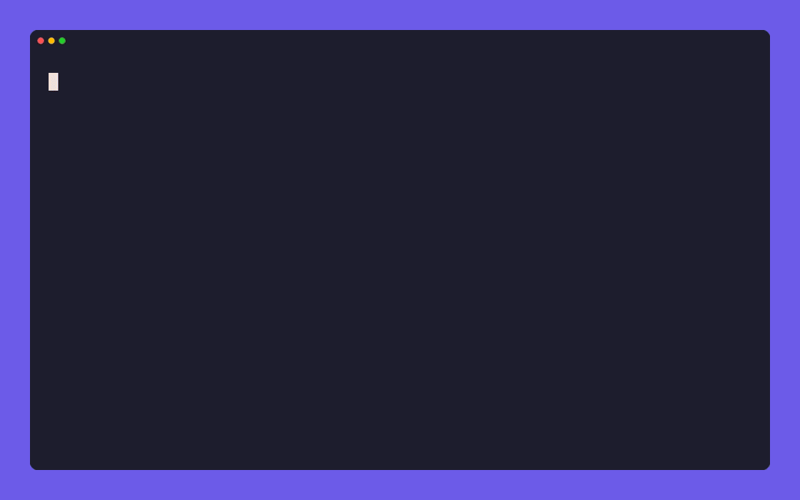
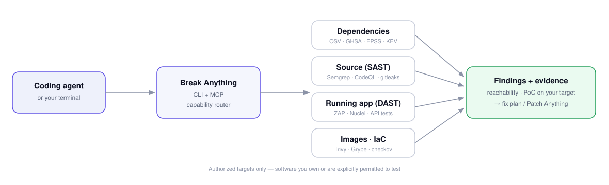

<div align="center">

**English** · [简体中文](docs/readme/README_zh.md)

# Break Anything

### Your scanner lists 400 vulnerabilities. Which 3 can actually reach you?

Point your coding agent at code you own. Break Anything finds the weaknesses that are **truly
reachable**, proves them on your own build, and fixes them — before anyone else does.

*Security scanning, minus the noise.*

[](https://www.npmjs.com/package/break-anything)
[](docs/mcp-tools.md)
[](DISCLAIMER.md)
[](LICENSE)

**[Quick start](#quick-start) · [Why it's different](#why-its-different) · [See it in 30s](#see-it-in-30-seconds) · [The arsenal](#the-arsenal) · [FAQ](#faq)**

<code>npx break-anything setup</code>

</div>

> [!IMPORTANT]
> Break Anything tests software **you own or are explicitly authorized to test**. Every
> proof-of-concept runs against your own target. It's a defensive tool, not an attack framework,
> and must never be pointed at third-party systems.

<div align="center">

<!-- Record with: vhs demos/hero.tape -->


</div>

---

`npm audit` reports 47 vulnerabilities. `trivy` reports 300 more. You don't have time to triage
400 findings, so you bump a few versions and hope. Meanwhile the one that's *actually reachable
from your code* sits there, and a key you deleted last spring is still sitting in your git
history.

**Break Anything cuts the noise.** Ask your agent in one sentence; it runs the right scanners,
then tells you the three things that can actually hurt you — each with a proof-of-concept built
against *your* build and a fix ready to apply. Everything runs locally. Nothing is pointed
anywhere you don't own.

## Quick start

```bash
npx break-anything setup
```

Pick your agent, approve the changes, restart. Works with Claude Code, Codex, Cursor, Gemini CLI,
Windsurf, and anything that runs a local MCP server. Then just ask:

```text
Use Break Anything on this project. Show me only the vulnerabilities that are
actually reachable in my code, prove the worst one, and give me the fix.
```

Prefer the terminal? One command, shipped today:

```bash
npx -y break-anything deps ./              # dependency CVEs, ranked by reachability + EPSS
npx -y break-anything secrets ./ --history # leaked keys in the tree and full git history
npx -y break-anything image my-svc:latest  # OS + app CVEs in a container image
```

## Why it's different

Every scanner can hand you a list. The list is the problem. Break Anything is built around the
three things a list can't do:

- **Reachability, not presence.** It separates `confirmed` → `reachable` → `present` →
  `not-reachable`. The vulnerable `lodash` you never call is noise; the one on a live code path is
  the finding. You triage 3, not 400.
- **Proof, not prose.** Instead of a CVSS paragraph, it builds a proof-of-concept against *your*
  build — the exact input or request that breaks it — so "theoretically vulnerable" becomes
  "here's the repro."
- **A fix, even when upstream is gone.** No patched version because the maintainer vanished? It
  proposes a patch, a pin, a compatibility shim, or a maintained fork — so an abandoned dependency
  doesn't become your breach. Hand it to [Patch Anything](#companion-patch-anything) for a
  merge-ready PR.

It doesn't replace OSV, Trivy, Semgrep or ZAP — it **orchestrates** them behind one agent
interface and does the reasoning they can't.

## See it in 30 seconds

Three things you'll reach for it, each one sentence to your agent:

| The moment | Ask | What you get back |
| --- | --- | --- |
| **"A CVE is trending — are we hit?"** | *"Scan my deps, only flag what's reachable."* | 3 reachable CVEs with fix versions — not a 400-line wall |
| **"Did someone commit a key?"** | *"Scan the repo and git history for secrets."* | The leaked key, the commit that introduced it, "rotate don't delete" |
| **"Can user A read user B's data?"** | *"Check /orders/:id for broken access control."* | The IDOR, proven against localhost with two accounts |

## What you point it at

You don't pick a mode. Hand it whatever you have — it detects the form and routes to the right
engine.

| You give it | Form | Categories |
| --- | --- | --- |
| A repo or source tree | source / tech stack | SCA, SAST, Secrets |
| A lockfile (`package-lock.json`, `composer.lock`, `go.mod`…) | manifest | SCA |
| A container image | build artifact | Containers |
| An APK / IPA or compiled binary | build artifact | Mobile, Fuzzing |
| A Terraform / Kubernetes / Dockerfile | config | IaC |
| A running URL or API (yours) | live system | DAST, API |
| Cloud credentials (yours) | live account | Cloud posture |
| Git history | repo metadata | Secrets |

## The arsenal

Organized by scan category — the language security teams speak — each orchestrating tools that
already run in real pipelines. ✅ shipped in 0.1.0 · 🧭 on the roadmap.

### ✅ Shipped today

- **Dependencies (SCA)** — known CVEs across your whole tree, ranked by reachability + EPSS, with fix versions. Engines: [OSV](https://osv.dev), [Trivy](https://github.com/aquasecurity/trivy), [Grype](https://github.com/anchore/grype), `pip-audit`, `govulncheck`, `composer audit`. Ecosystems: npm, PyPI, Composer, Go, Maven, Cargo, RubyGems, NuGet.
- **Secrets** — leaked keys/tokens/private keys in the working tree and full git history, redacted. Engines: [Gitleaks](https://github.com/gitleaks/gitleaks), [TruffleHog](https://github.com/trufflesecurity/trufflehog).
- **Container images** — OS + app CVEs, Dockerfile smells, secrets in layers. Engines: [Trivy](https://github.com/aquasecurity/trivy), [Grype](https://github.com/anchore/grype), [Hadolint](https://github.com/hadolint/hadolint).

### 🧭 On the roadmap

- **Static code (SAST)** — injection, broken access control, deserialization, SSRF, with data-flow. [Semgrep](https://semgrep.dev), [CodeQL](https://codeql.github.com), Bandit, gosec, Brakeman.
- **Infrastructure (IaC)** — public buckets, open ports, broad IAM before `apply`. [Checkov](https://www.checkov.io), tfsec, Terrascan, KICS.
- **Running apps (DAST)** — OWASP Top 10 against your authorized app. [OWASP ZAP](https://www.zaproxy.org), [Nuclei](https://github.com/projectdiscovery/nuclei), sqlmap.
- **API** — BOLA/IDOR, broken auth, mass assignment. [Schemathesis](https://github.com/schemathesis/schemathesis).
- **Cloud posture · Attack surface · Smart contracts · Mobile · Fuzzing** — Prowler, Nmap + ProjectDiscovery, [Slither](https://github.com/crytic/slither), [MobSF](https://github.com/MobSF/Mobile-Security-Framework-MobSF), [AFL++](https://github.com/AFLplusplus/AFLplusplus).

Full per-tool catalog and MCP contracts: [docs/mcp-tools.md](docs/mcp-tools.md). Every dynamic
(traffic-sending) category is **off by default** and refuses any target not on your allowlist.

## How it works

Your agent calls Break Anything over MCP to inspect a target you control. It routes to the right
engine, confirms reachability, and returns each finding with its evidence and a fix. The CLI uses
the same workflows.



**Find** weaknesses across deps, code, secrets, images, IaC, and running apps → **Prove** the
finding is reachable with a PoC against your target → **Fix** it inline or via Patch Anything.
Absence of a finding is never reported as proof of safety.

## Companion: Patch Anything

> **Break Anything** finds it and proves it → **[Patch Anything](https://github.com/EnkiHQ/patch-anything)** fixes it.

Hand any finding over and it drafts the patch, bump, shim, or fork. Discovery and repair, one
loop. Use either alone, or run it end to end.

## FAQ

<details>
<summary><strong>How is this different from `npm audit` / Trivy / Snyk?</strong></summary>

They report presence — every vulnerability that exists anywhere in your tree. Break Anything adds
**reachability** (is it actually called), **proof** (a PoC against your own build), and
**self-remediation** when upstream has no fix, and unifies deps, code, secrets, images, IaC, and
runtime behind one agent interface.

</details>

<details>
<summary><strong>Does it replace those tools?</strong></summary>

No — it orchestrates them. Break Anything is the brain and the interface; OSV, Trivy, Semgrep, ZAP
are the engines. You get their depth without learning each one.

</details>

<details>
<summary><strong>Is this an attack tool? Will my repo get taken down?</strong></summary>

No. It's defensive and authorized-targets-only; every PoC runs against your own target and it
ships no weaponized exploits. See [DISCLAIMER.md](DISCLAIMER.md). GitHub policy explicitly supports
dual-use security research.

</details>

<details>
<summary><strong>Does it upload my code?</strong></summary>

Analysis runs locally. Your agent receives the results; its model provider has its own data
policy — review that separately.

</details>

<details>
<summary><strong>Which agents can use it?</strong></summary>

Any agent that supports local MCP servers. Setup configures the common ones automatically.

</details>

## Documentation

[Installation](docs/installation.md) · [Tool catalog & MCP contracts](docs/mcp-tools.md) ·
[Roadmap](docs/roadmap.md) · [Security model](SECURITY.md) · [Responsible use](DISCLAIMER.md)

## License

[MIT](LICENSE). Break-authored code is MIT; the engines it orchestrates keep their own licenses —
see [THIRD_PARTY_NOTICES.md](THIRD_PARTY_NOTICES.md).
